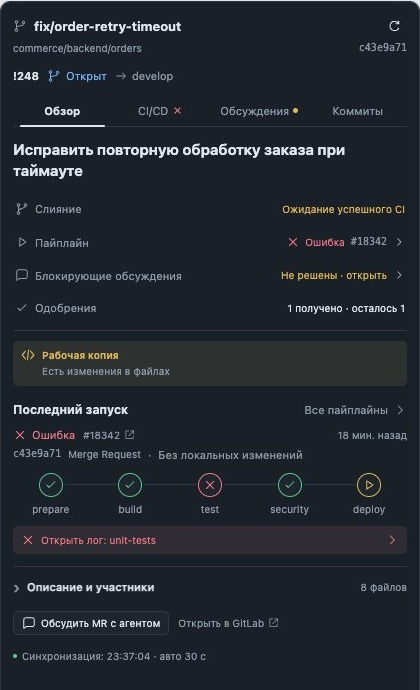
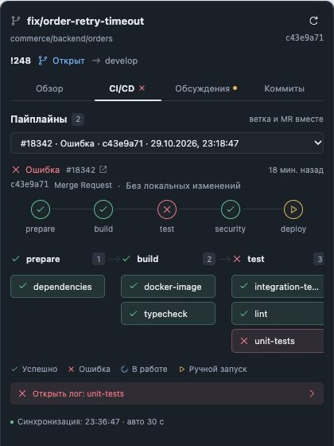
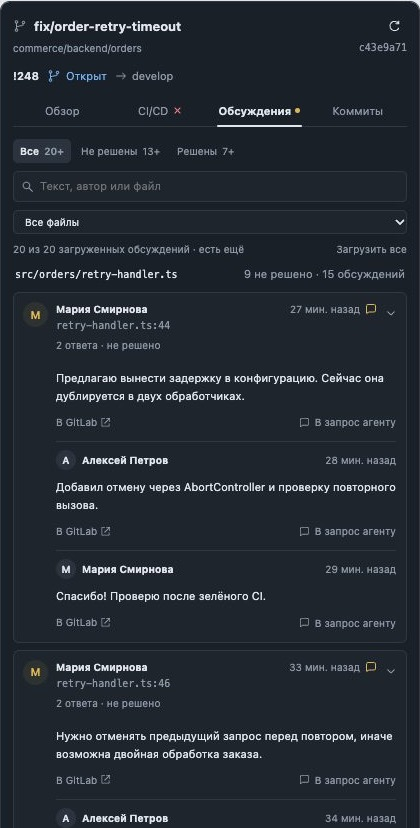

# GitLab Branch for BB

The GitLab merge request for your thread's branch, beside the conversation.
Merge status, CI stages and job logs, commits and review discussions with the
code around each comment — read from the real worktree, never changed.

Works with GitLab.com and self-managed GitLab, including machines reached
through BB. Requires BB 0.48+, `git` and an authenticated `glab`.

<p align="center">
  
  
  
</p>

_Screenshots are rendered from the fixture-backed preview in `preview/`; they
contain no real project data._

## What you get

### Overview

Merge status, the latest pipeline, blocking discussions and approvals in four
rows, with the factual GitLab state and no generated readiness verdicts. The
panel follows the actual worktree: local branch, HEAD, upstream SHA, dirty files
and ahead/behind. When the pipeline checked a different commit than your local
HEAD, it says so. Description and participants stay collapsed until you need them.

### CI/CD

Branch and merge request pipelines are combined into one list. The selected
pipeline is drawn as ordered stages with parallel jobs, semantic colors and a
stage navigator. Pick a job to read its log inline. Logs are cleaned of terminal
escapes, and a log GitLab cannot return is explained instead of shown as empty.
Stage order comes from a read-only GraphQL query; when it is unavailable, jobs are
still grouped but no connectors are invented.

### Discussions

Review threads are grouped by file, files with unresolved threads first, with
general merge request comments last. Unresolved threads open with the code around
the comment shown above it and the commented line highlighted, read from the
revision the comment was written on. Search by text, author or file, filter by
state, and load every page when you need a complete count: counts are marked
"+" until all pages are loaded. GitLab's own events (status changes, assignments)
are kept apart under the merge request history, so they do not pass for reviewer
comments.

### Commits

Published branch history with the real parent relationships, including merges.

### Agent integration

- Insert a review comment, merge request or job log into the chat draft. Nothing
  is sent for you.
- Read-only agent tools: `gitlab_branch`, `gitlab_mr`, `gitlab_discussions`,
  `gitlab_mr_pipelines`, `gitlab_jobs` and `gitlab_job_log`.
- `bb gitlab-branch branch [--thread <id>]` prints the branch, merge requests and
  pipelines as JSON, and a bundled skill describes the workflow.

## Install

```sh
bb plugin install git:https://github.com/viartemev/bb-gitlab-branch.git
```

or from a checkout:

```sh
npm install --include=dev
npm run typecheck
npm test
bb plugin build
bb plugin install .
```

Authenticate on the machine that holds the worktree with `glab auth login`.
In BB open **Plugins → GitLab Branch**. For ordinary GitLab hostnames no settings
are needed. For a custom hostname (for example `code.company.com`), enter it
without a scheme or path. Set Remote only to override automatic upstream/origin
discovery. An optional secret personal access token with `read_api` can be saved
in the plugin settings (the hostname must then be configured explicitly); it never
goes to frontend results or process arguments. VPN and corporate CA trust must work
for `glab` on the environment machine. TLS verification is never disabled.

Open **GitLab** from the thread header or the side panel's tab selector. The
plugin can be installed while a GitHub repository is open; it shows an explicit
non-GitLab state until you open a GitLab worktree.

## Scope and limitations

The plugin only reads GitLab. Commenting, resolving discussions, retrying jobs and
merging are deliberately not included. Every detail read checks the checkout
identity, so a stale branch or commit is rejected. Data stays as fresh as the last
refresh, whose exact time is shown; the panel refreshes every 30 seconds while
visible. This plugin never fetches git refs.

- Approvals may be unavailable depending on GitLab edition, version or permissions.
- Fork merge requests are discovered in the fork's parent project and validated
  against the source project and remote branch.
- GitLab installed under a URL subpath is not supported.
- All lists paginate explicitly. Discussion filters and counts apply to loaded pages.
- If GitLab reports a stored job log but returns zero bytes from the trace API, the
  panel reports the discrepancy and links to GitLab. It cannot retrieve contents
  the instance does not return.
- Job traces are capped at the last 48,000 characters and `glab` output at 8 MiB.
  Large comments and descriptions are bounded, and context insertion marks any
  shortened text.
- Code context shows a few lines of the file at the revision of the comment; it is
  unavailable for comments without a file position or for files the token cannot read.
- Credentials and raw remote URLs are not exported in errors.

## Development

`npm run typecheck`, `npm test`, `npm run build`. Tests use the public BB backend
and frontend harnesses and fixture-backed GitLab API responses. Host code uses
Node `child_process` with argument arrays (no shell); REST reads use GET and the
GraphQL stage-order query uses POST, never mutations.

`preview/` is a fixture-backed browser preview (no credentials or real requests)
for 320/420/680 px panels, light and dark themes, and failed, running and ready
merge requests. Build `preview/main.tsx` with esbuild, aliasing
`@get-bb/plugin-sdk/app` to `preview/sdk.tsx`, and serve that directory. Preview
bundles are not committed.

## License

MIT
